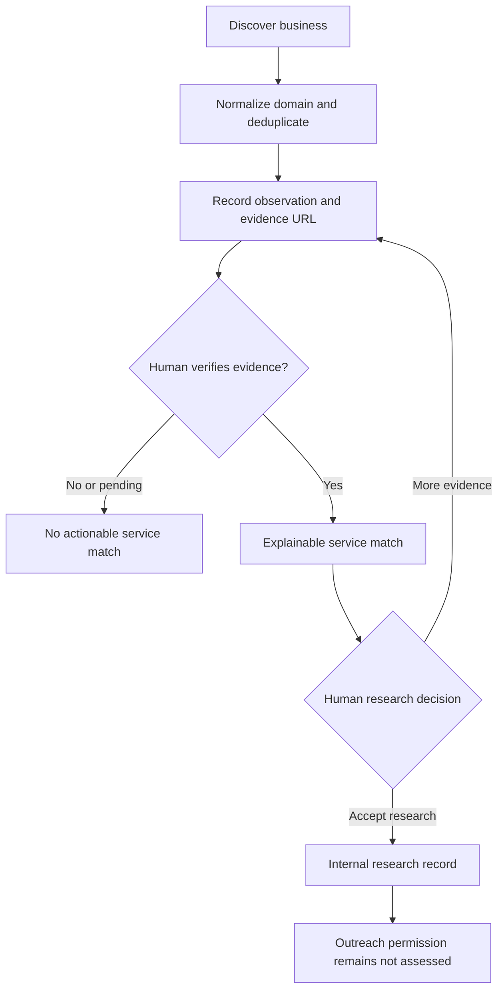

# Architecture & evidence boundaries

The [LeadNoria public page](https://mehedihasan.work/leadnoria/) presents an eight-stage B2B research workflow: business discovery, qualification, technical site audit, service matching, contact discovery, contact screening, CRM organization, and interested reply review.

This **independently written reference code** implements only a narrow, *non-operational* research subset of that concept. It cannot establish implementation details of the private production platform.

## State and data model

- Tenant boundary: all reads/writes require an owner scope provided by a trusted host application. This is **not authentication**; caller identity is injected by the host.
- Business identity: normalized domain within a tenant; repeated discovery appends unique source provenance.
- Finding: a known technical observation category, evidence pointer, timestamp, human review status and reviewer ID.
- Match: a deterministic, explainable service suggestion that references verified findings, **not** a claim of guaranteed business benefit.
- Research decision: a human reviewer may accept for *internal research* after finding and match review; this **does not** authorize any marketing outreach.
- Contact route: public form URL pointer, explicitly not proof of consent, not treated as send-ready.

## Non-features and production risks

This example **does not fetch remote URLs**. URL validation is demonstration-level input validation, not an SSRF defense for a real crawler. It accepts only public-looking HTTP(S) DNS names; production fetchers would need DNS resolution checks, IP range restrictions on every redirect, timeouts, response budgets, proxy controls and permission review.

The in-memory store is not durable, distributed, or transaction-safe. Production would need PostgreSQL constraints, owner-level authorization enforced server-side, auditable immutable evidence, retention/deletion policies, workflow idempotency across instances, security monitoring and safe rate controls. There is no UI, queue worker, API endpoint, LLM integration, email delivery or reply ingestion in this example.

**Security principle:** Research quality, data source legitimacy, recipient permission and the actual ability to send are separate decisions. A public address or contact form is not permission to send unsolicited messages.
